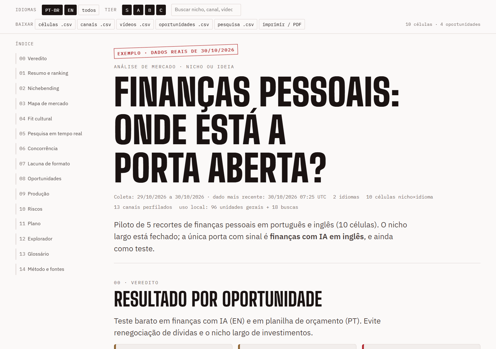
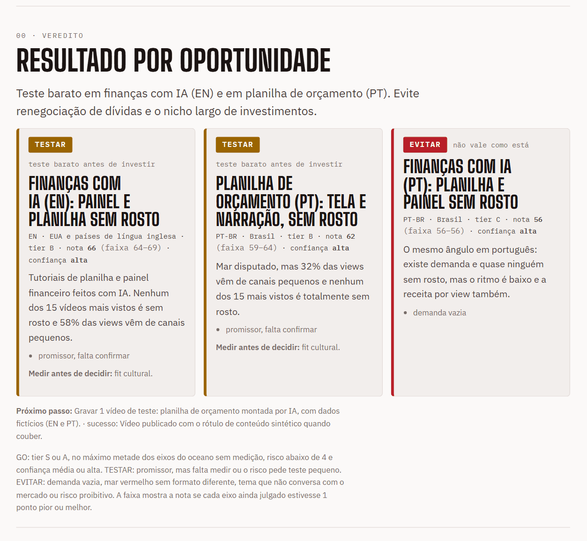
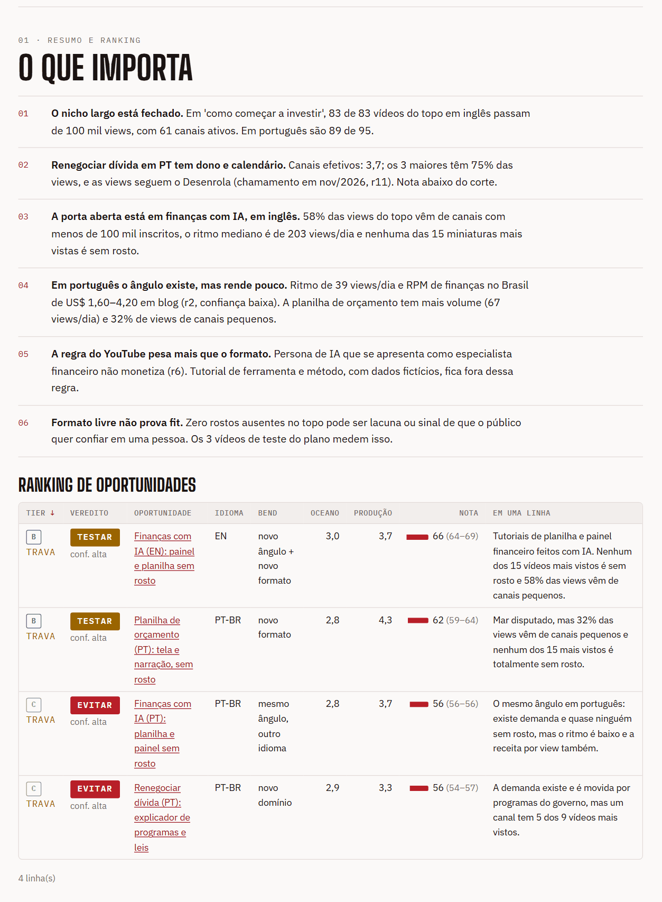
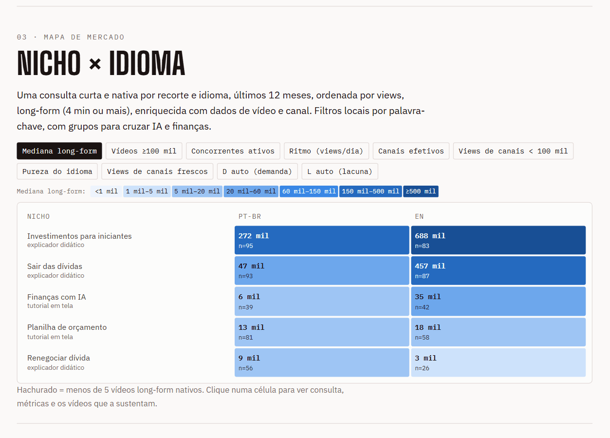
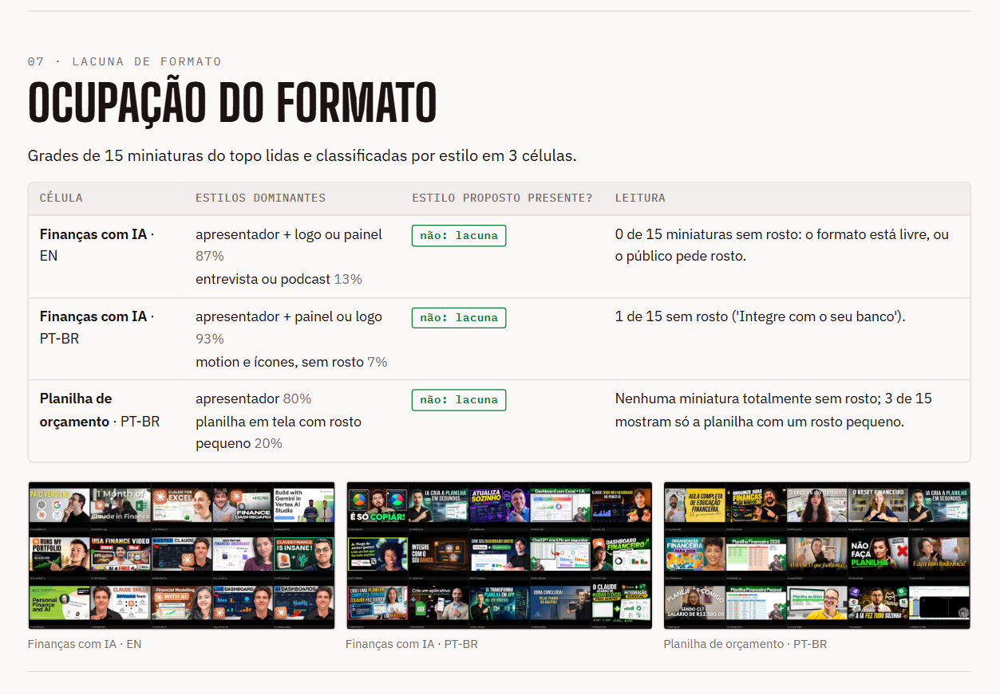
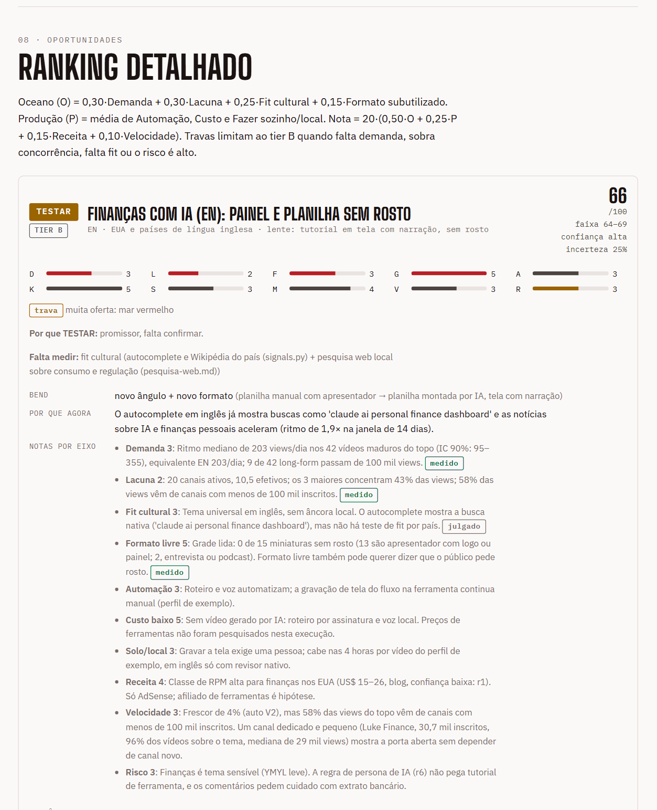

# DarkNiche

Analisador de nichos do YouTube. Funciona como skill para agentes de código (Claude Code, Codex, OpenCode, Antigravity) e como notebook para o Google Colab.

Você passa um nicho, uma ideia, um canal ou um vídeo. A skill mede o mercado com dados reais da YouTube Data API, pesquisa a web no mesmo dia e entrega um relatório em português. Cada oportunidade recebe um veredito: **GO**, **TESTAR** ou **EVITAR**.

Foi feita para quem monta canais faceless e automatizados, mas serve para qualquer nicho. `analise-mercado-yt` é o nome da skill dentro do agente. DarkNiche é o nome da ferramenta.

[](https://github.com/darksemfiltro/darkniche/actions/workflows/tests.yml) [](https://colab.research.google.com/github/darksemfiltro/darkniche/blob/main/analise-mercado-yt/extras/colab/DarkNiche.ipynb)   

<p align="center">
  <picture>
    <source media="(prefers-color-scheme: dark)" srcset="docs/img/01-topo-escuro.png">
    
  </picture>
</p>

O exemplo é real: piloto de finanças pessoais em português e inglês, coletado em 30/10/2026. Baixe o [relatório completo](exemplos/relatorio-exemplo.html) e abra no navegador, ou leia o [PDF](exemplos/relatorio-exemplo.pdf) direto no GitHub.

## O que ela responde

- Existe demanda? Em views por dia, e não só em views acumuladas.
- Quem ocupa o espaço, e sobra porta para um canal pequeno?
- O tema conversa com o país e o idioma?
- Quanto paga, e qual regra do YouTube pesa para esse formato?
- Dá para produzir do seu jeito, com as suas ferramentas e as suas horas?

Cada fato externo vem com URL e data de acesso, e cada número medido com a data da coleta. O que foi medido fica separado do que foi julgado. Todo vídeo ou canal citado tem link.

## O relatório por dentro

O relatório é um arquivo HTML único, com filtros por idioma e tier, busca, exportação em CSV e impressão em PDF. Segue o tema claro ou escuro do sistema.

**Veredito por oportunidade**, com nota, faixa, confiança e o que ainda falta medir:



**Achados e ranking.** O ranking ordena por tier, veredito ou nota:



**Mapa nicho × idioma.** A mesma célula pode ser lida por mediana, ritmo, concorrentes ativos ou porta aberta:



**Ocupação do formato.** Grades das miniaturas do topo, classificadas por estilo, para achar o formato que ninguém usa:



**Cada oportunidade abre em dez eixos**, e cada nota diz se foi medida ou julgada:



As miniaturas e os nomes de canais que aparecem nas imagens são públicos e pertencem aos seus donos. Entram só como exemplo de análise. O tour completo, seção por seção, está em [docs/relatorio.md](docs/relatorio.md).

## Instalação rápida

Você precisa de Python 3.10 ou mais novo e de uma chave da YouTube Data API v3. A chave é grátis e é sua: o [guia de instalação](docs/instalacao.md#1-pegue-a-chave-da-api) mostra como criar.

### Com uma LLM (recomendado)

Abra o seu agente de código (Claude Code, Codex, OpenCode ou Antigravity) numa pasta qualquer e cole o prompt abaixo. O agente baixa o repositório, escolhe o instalador certo para o seu sistema, instala a skill e confere o resultado.

````text
Instale a skill DarkNiche (analise-mercado-yt) neste computador.

Repositório: https://github.com/darksemfiltro/darkniche
Guia: https://github.com/darksemfiltro/darkniche/blob/main/docs/instalacao.md

1. Clone o repositório numa pasta temporária (ou baixe o ZIP) e leia o docs/instalacao.md.
2. Descubra meu sistema e qual agente eu uso. Rode o instalador do sistema só para o meu agente:
   Windows: powershell -ExecutionPolicy Bypass -File .\install.ps1 -Agent <claude|codex|opencode|antigravity> -NonInteractive
   macOS, Linux ou WSL: bash install.sh --agent <claude|codex|opencode|antigravity> --non-interactive
3. Não peça nem leia a minha chave da YouTube Data API no chat. Se ela ainda não estiver configurada, me diga para rodar o instalador sem -NonInteractive num terminal meu (ele pede a chave sem mostrá-la), ou para definir a variável de ambiente YT_API_KEY.
4. Rode analise-mercado-yt/scripts/selftest.py e analise-mercado-yt/scripts/doctor.py e me mostre o resultado.
5. Me diga em que pasta a skill ficou e qual pedido de teste eu posso fazer.
````

Se a chave ainda não existe, o [guia](docs/instalacao.md#1-pegue-a-chave-da-api) mostra como criar. Nunca cole a chave na conversa com o agente.

### Manual

1. Baixe o repositório (**Code > Download ZIP**, ou `git clone`) e abra a pasta num terminal.
2. Rode o instalador. Ele copia a skill, pede a chave sem mostrá-la, instala yt-dlp e Pillow e roda a checagem.
3. Abra o agente e peça a análise.

Windows (PowerShell):

```powershell
powershell -ExecutionPolicy Bypass -File .\install.ps1
```

macOS, Linux ou WSL:

```bash
bash install.sh
```

Sem opções, o instalador atende o Claude Code. Para os outros agentes, escolha com `-Agent` (Windows) ou `--agent` (bash):

| Agente | Windows | macOS, Linux, WSL |
|---|---|---|
| Claude Code | `.\install.ps1 -Agent claude` | `bash install.sh --agent claude` |
| Codex | `.\install.ps1 -Agent codex` | `bash install.sh --agent codex` |
| OpenCode | `.\install.ps1 -Agent opencode` | `bash install.sh --agent opencode` |
| Antigravity | `.\install.ps1 -Agent antigravity` | `bash install.sh --agent antigravity` |
| Todos | `.\install.ps1 -Agent all` | `bash install.sh --agent all` |

O [guia de instalação](docs/instalacao.md) traz as pastas de cada agente, a instalação manual, a troca de chave e a solução dos problemas mais comuns.

## Usar

Peça em linguagem natural:

- "Analise o nicho de finanças pessoais em PT e EN."
- "Tive a ideia de um canal sobre acidentes aéreos explicados. Vale a pena? Em quais mercados?"
- "Quero modelar o canal https://www.youtube.com/@exemplo."
- "Não sei o nicho. Ache oportunidades para canal faceless em espanhol."

Os idiomas padrão são português, inglês e espanhol. Peça outros quando quiser (francês, alemão, japonês, coreano, indonésio, turco, polonês e mais). Os 38 idiomas da tabela têm região e tamanho de mercado; fora dela, a nota de demanda fica em no máximo 3.

A skill mostra o plano com o custo em buscas e espera o seu ok antes de gastar a cota. Na primeira análise ela pergunta as suas ferramentas, as horas por vídeo e o orçamento, para dar as notas de produção, e guarda as respostas em `~/.analise-mercado-yt/perfil.json`. Cada análise vira uma pasta `analises/<tema>-<ano-mês>/` com o plano, os dados coletados, o julgamento e o `relatorio.html`.

## Dois caminhos

| | 1. Agente de código | 2. Colab grátis |
|---|---|---|
| Quem escreve o julgamento | o agente que você já usa | uma IA gratuita (IA do Colab ou Gemini API) |
| Pesquisa web do dia (RPM, regras, notícias) | sim, com fonte e data | não: receita e risco saem do conhecimento do modelo e o relatório avisa |
| Escolha do escopo | conversa | seletores no notebook |
| Custo | a sua assinatura | grátis, dentro dos limites da sua conta |
| Estado | usado no Claude Code; Codex, OpenCode e Antigravity leem as pastas documentadas por eles, sem teste de uso | experimental: testado com IA simulada, ainda não no Colab real |

Os dois usam os mesmos scripts, a mesma chave da YouTube Data API e o mesmo relatório. Com um agente, comece pelo caminho 1. Use o caminho 2 para uma primeira passada grátis.

## Colab

1. Baixe `DarkNiche-Colab.zip` na página de Releases (ou gere com `python analise-mercado-yt/extras/colab/package_colab.py`).
2. No Colab, abra `analise-mercado-yt/extras/colab/DarkNiche.ipynb`, envie o ZIP, guarde a chave em Secrets e use Executar tudo.

Passo a passo no [guia de instalação](docs/instalacao.md#colab-sem-agente) e limites em [analise-mercado-yt/extras/colab/colab.md](analise-mercado-yt/extras/colab/colab.md).

## Como ela decide

- **API primeiro.** Só ela filtra região, idioma e data juntos. O yt-dlp complementa: entra quando a API não basta (transcrição, miniaturas, busca do dia esgotada) ou quando é melhor e mais barato (amplitude, sondagens de títulos, tema global). Num teste real, a mesma consulta deu o mesmo top 15 e a mesma concentração de canais nos dois, e o yt-dlp gastou 0 buscas da cota. A mediana de views diferiu (9,1 mil na API, 6,5 mil no yt-dlp) e mexeu a nota de demanda em um degrau.
- **Demanda.** Views por dia dos vídeos com 14 dias ou mais, convertidas para o equivalente em inglês pelo tamanho do mercado do idioma.
- **Concorrência.** Canais efetivos (quantos disputam de verdade) e porta aberta (a fatia das views que vem de canais com menos de 100 mil inscritos).
- **Pesquisa web.** RPM, regras do YouTube, notícias e calendário entram no relatório com URL, data de acesso e nível de confiança.
- **Veredito.** Sai da nota (0 a 100), das travas (demanda vazia, mar vermelho, fit ruim, risco alto, pouca medição), da confiança e do risco. A faixa mostra quanto a nota mudaria se cada eixo ainda julgado errasse um ponto.

## Cota e custo

A API tem dois limites por dia (padrão): 100 buscas e 10.000 unidades gerais. Um piloto de 3 recortes em 3 idiomas, só long-form, usa 18 buscas. A cota vira à meia-noite do Pacífico. O contador local é conservador e não vê o uso em outras máquinas. `AMY_HOME` muda a pasta da chave e do perfil; `AMY_DATA`, a do cache e do contador.

## Limitações

- Sem chave de API a análise roda em modo reduzido (sem data, inscritos nem idioma declarado) e o `score.py` não deixa o veredito passar de TESTAR.
- O topo da busca por views mede o teto do nicho, não o vídeo típico. A tendência vem de outros sinais: Wikipédia, autocomplete, "em alta" e notícias.
- RPM e preços vêm da pesquisa web do dia e de blogs de terceiros. Confirme antes de decidir dinheiro. O veredito apoia a decisão e não promete resultado.
- O yt-dlp quebra quando o YouTube muda: `pip install -U yt-dlp`.
- Testado no Windows. Linux e macOS usam os mesmos scripts e o instalador bash, e o fluxo de testes roda neles no GitHub Actions, mas ninguém abriu a skill num agente nesses sistemas.
- O relatório carrega as fontes do Google Fonts pela rede; sem internet, usa fontes do sistema.
- O relatório de exemplo traz dados da YouTube Data API de 30/10/2026. A [política de desenvolvedores da API](https://developers.google.com/youtube/terms/developer-policies) pede que dados guardados (título, nome do canal, contagens) sejam atualizados ou apagados em até 30 dias. Trate o exemplo como o retrato de um dia e gere o seu. O cache da skill vale de 20 horas a 7 dias; a pasta de cada análise guarda o que você coletou, e o prazo de apagar ou refazer é seu.

## Segurança e privacidade

A chave do YouTube fica só na variável de ambiente ou em `~/.analise-mercado-yt/.env`, viaja em cabeçalho (nunca na URL) e é mascarada nas mensagens de erro. A skill fala com o YouTube (API, autocomplete e yt-dlp), a Wikipédia e o Wikidata, o Google Trends e o Google Notícias (RSS), além das buscas web do seu agente. O `gemini_video.py`, opcional, envia a URL do vídeo à Gemini API. Se você definir `AMY_CONTACT` (e-mail ou URL) no `.env`, esse contato vai no User-Agent das consultas à Wikipédia, como a política da Wikimedia pede. No Colab, o pedido e os dados públicos do piloto vão ao provedor de IA que você configurar. Para reportar uma falha de segurança, veja [SECURITY.md](SECURITY.md).

## Testes e contribuições

```bash
python -m unittest discover -s tests
python analise-mercado-yt/scripts/selftest.py
```

Os dois rodam offline e não gastam cota. Veja [CONTRIBUTING.md](CONTRIBUTING.md) para abrir um issue ou um pull request.

## English

DarkNiche is a YouTube niche analyzer. It ships as a skill for coding agents (Claude Code, Codex, OpenCode, Antigravity) and as a Google Colab notebook. Give it a niche, an idea, a channel or a video. It measures the market with the YouTube Data API (you bring your own free key), researches the web the same day, and writes an HTML report with a GO, TEST or AVOID verdict per opportunity.

Install: download the repo, then run `.\install.ps1 -Agent all` (Windows) or `bash install.sh --agent all` (macOS, Linux, WSL). The full guide is in [docs/instalacao.md](docs/instalacao.md), in Portuguese. The report, the prompts and the skill instructions are in Portuguese. The scripts and the data are language neutral, and the skill researches in any of 38 market languages.

## Licença

MIT, em [LICENSE](LICENSE). Terceiros em [THIRD_PARTY.md](THIRD_PARTY.md). Feito pelo canal **Dark Sem Filtro**.
