# Tour pelo relatório

Esta página mostra o relatório seção por seção, com o exemplo real do repositório: piloto de finanças pessoais em português e inglês, coletado em 30/10/2026. Você pode abrir o arquivo inteiro:

- [relatorio-exemplo.html](../exemplos/relatorio-exemplo.html). Baixe e abra no navegador. É o relatório como a skill o entrega, com filtros, ordenação, CSV e impressão.
- [relatorio-exemplo.pdf](../exemplos/relatorio-exemplo.pdf). A versão impressa, com 22 páginas, que o GitHub abre direto.

As imagens abaixo cortam as seções mais longas. No arquivo, elas continuam. Os nomes de canais e as miniaturas pertencem aos seus donos e aparecem só como exemplo de análise.

Os dados do exemplo são o retrato de um dia. Para o seu nicho, [gere o seu relatório](../README.md#usar).

## Antes da primeira seção

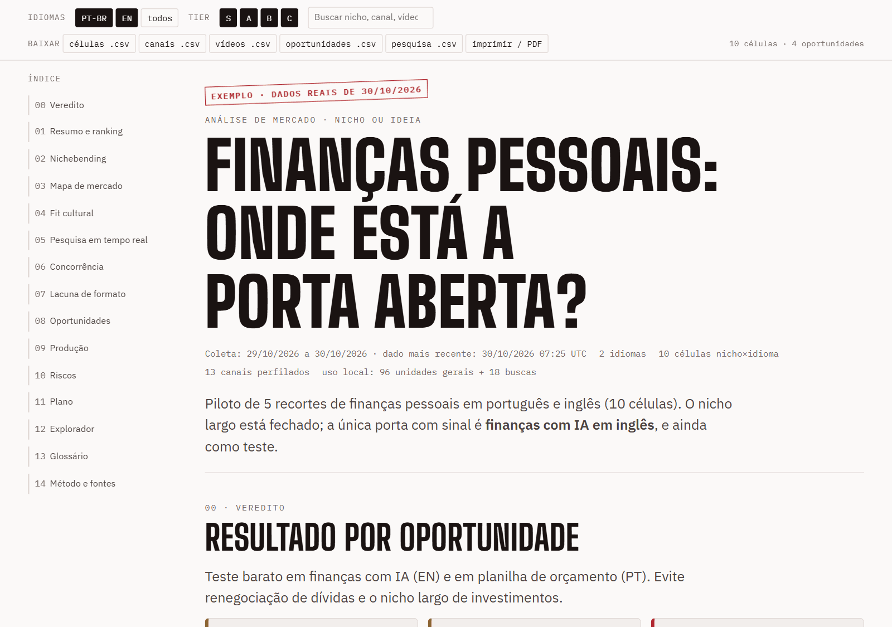

No topo ficam os filtros, que valem para as tabelas, o mapa e os gráficos:

- **Idiomas** e **Tier** (S, A, B, C) escondem o que você não quer ver.
- A caixa de busca procura por nicho, canal ou vídeo.
- **Baixar** exporta CSV de células, canais, vídeos, oportunidades e pesquisa, ou imprime em PDF.

À esquerda fica o índice, com as 15 seções. O carimbo vermelho marca o exemplo. Abaixo do título, a linha de coleta mostra as datas, o número de idiomas, de células (nicho × idioma) e de canais perfilados, e o uso de cota. O parágrafo seguinte resume a conclusão.

O relatório segue o tema do sistema. Em modo escuro fica assim:

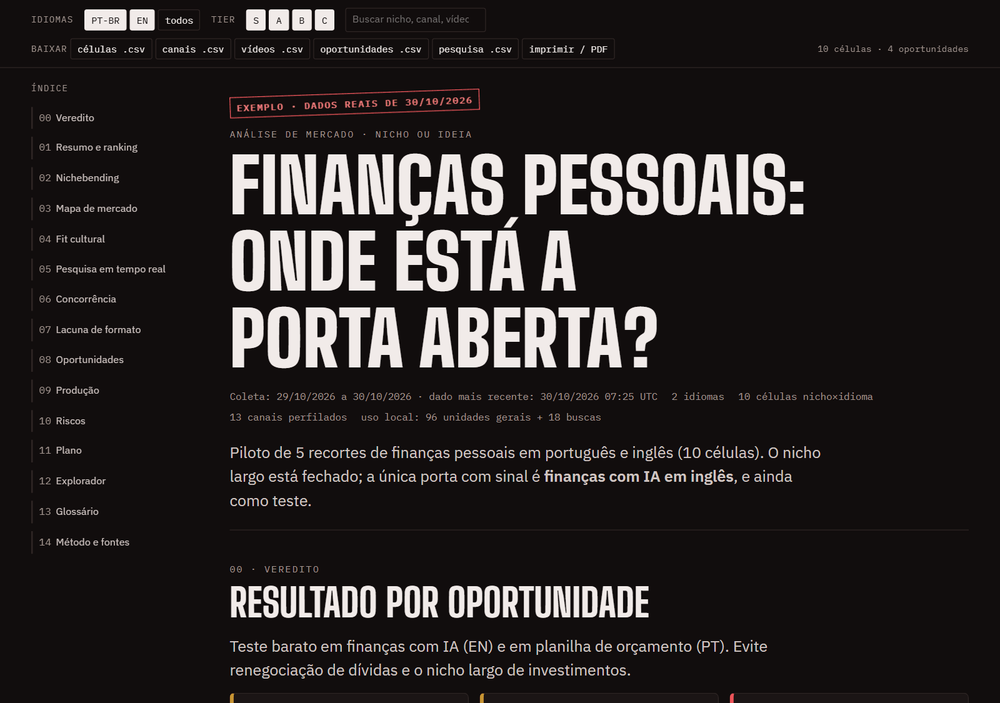

## 00 · Veredito

A resposta curta vem antes de qualquer tabela. Cada cartão traz o veredito (**GO**, **TESTAR** ou **EVITAR**), o nome da oportunidade, o idioma e o mercado, o tier, a nota com a faixa e a confiança. A faixa mostra quanto a nota mudaria se cada eixo ainda julgado errasse um ponto. "Medir antes de decidir" lista os eixos sem medição. Abaixo ficam o próximo passo e a regra de cada veredito.

## 01 · Resumo e ranking

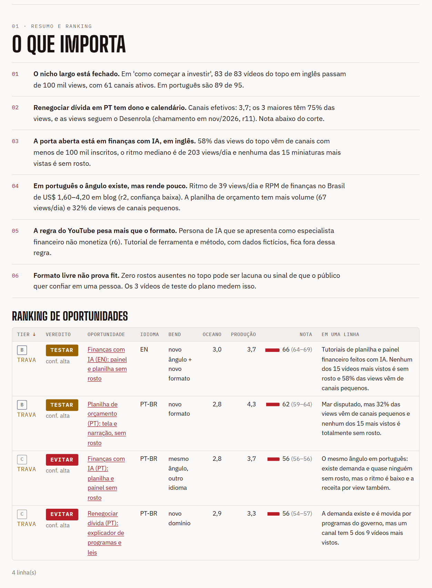

Os achados vêm numerados, com o número que sustenta cada um. O ranking ordena por tier, veredito, nota e outras colunas (clique no cabeçalho). A marca **trava** diz que uma regra limitou a nota. **Validar** diz que a incerteza passou de 50%. Cada nome leva ao detalhe da oportunidade.

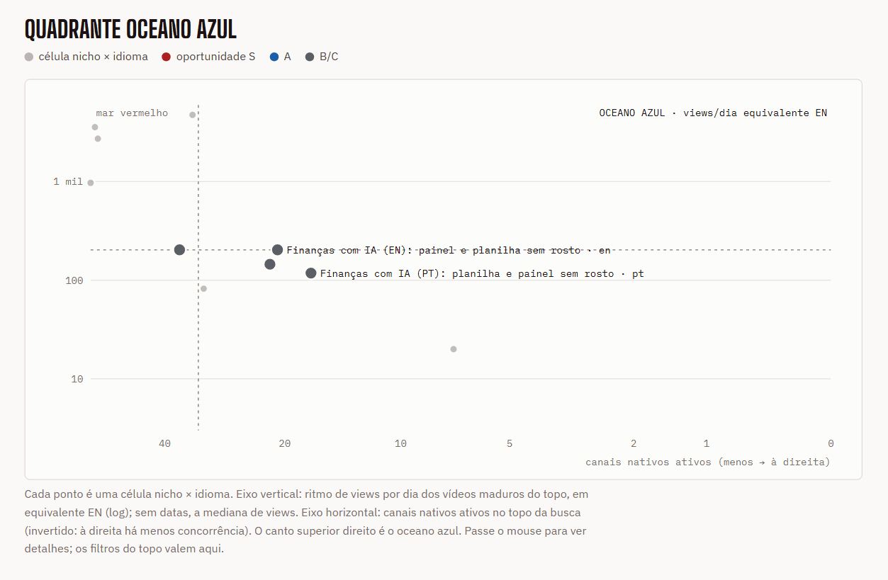

O quadrante põe uma célula nicho × idioma em cada ponto. Na vertical, o ritmo de views por dia dos vídeos maduros, em equivalente inglês. Na horizontal, os canais nativos ativos, invertidos: à direita há menos concorrência. O canto superior direito é o oceano azul.

## 02 · Nichebending

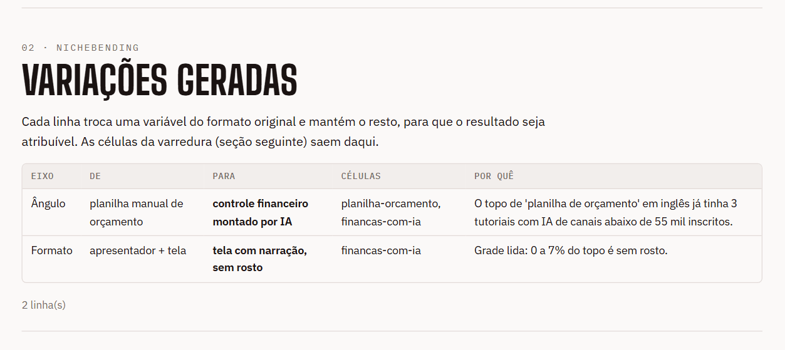

Cada linha troca uma variável do formato original (ângulo, formato, idioma) e mantém o resto. Assim o resultado pode ser atribuído à troca. A tabela mostra de onde, para onde, quais células testam a variação e por quê.

## 03 · Mapa de mercado

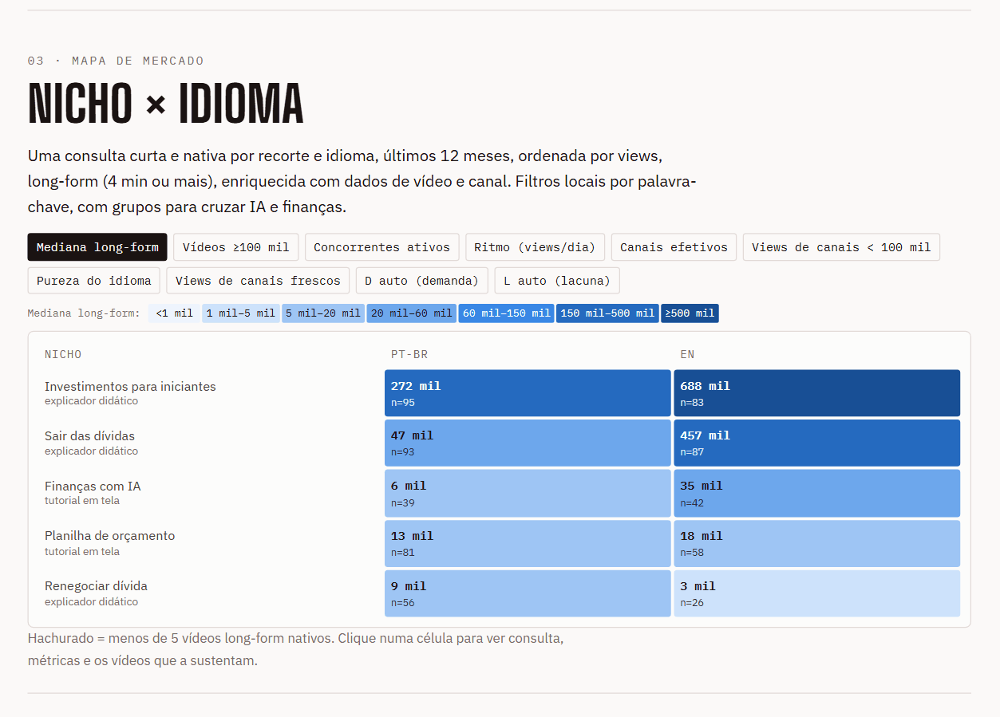

A matriz cruza nicho e idioma. Os botões trocam a métrica da cor: mediana de views, vídeos com mais de 100 mil views, concorrentes ativos, ritmo, canais efetivos, views de canais pequenos, pureza do idioma, views de canais frescos e as notas automáticas de demanda e lacuna. O número `n` é a quantidade de vídeos long-form nativos. Célula hachurada tem menos de 5. Clique numa célula para ver a consulta, as métricas e os vídeos que a sustentam.

## 04 · Fit cultural

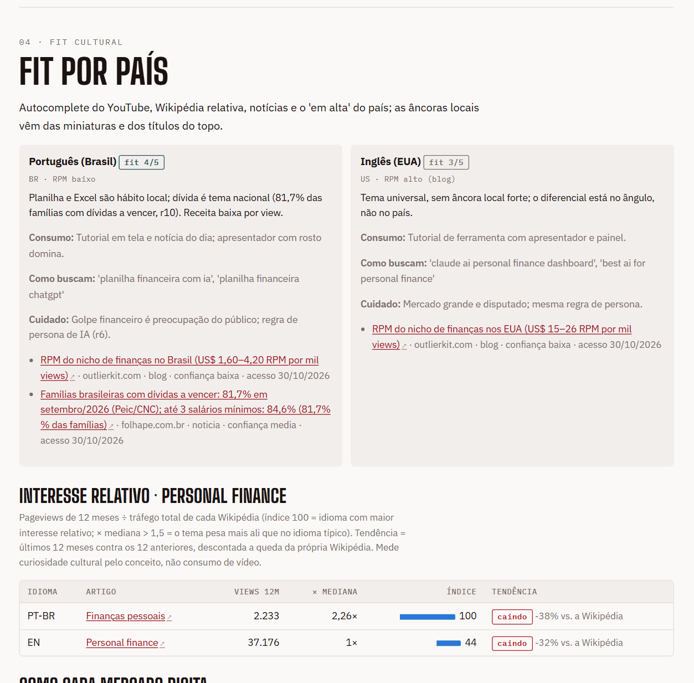

Um cartão por país mostra o fit de 1 a 5, a faixa de RPM, a âncora local, como o público consome, como busca e o cuidado a tomar, com as fontes. Abaixo vêm o interesse relativo na Wikipédia, com a tendência descontada da queda da própria Wikipédia, e o que o autocomplete do YouTube sugere em cada idioma.

## 05 · Pesquisa em tempo real

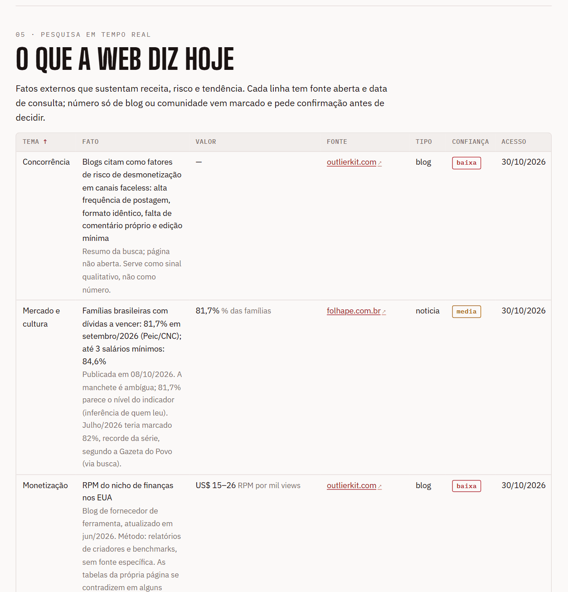

Os fatos externos que sustentam receita, risco e tendência. Cada linha tem fonte aberta, tipo (blog, notícia, oficial), nível de confiança e data de consulta. Número que vem só de blog ou comunidade aparece marcado com confiança baixa e pede confirmação antes de decidir dinheiro.

## 06 · Concorrência

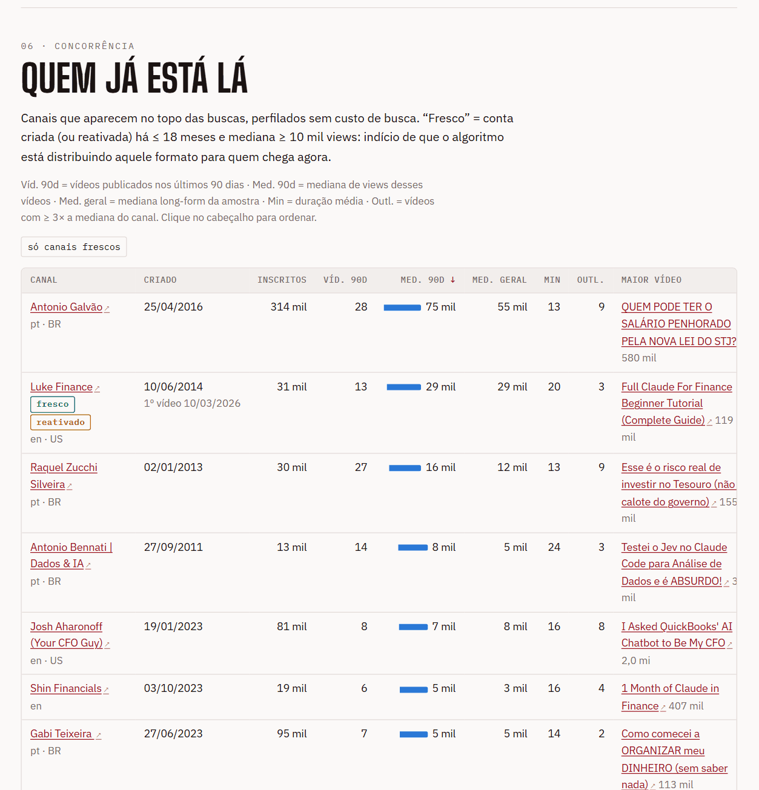

Os canais que aparecem no topo das buscas, perfilados sem custo de busca: criação, inscritos, vídeos dos últimos 90 dias, mediana de views nesses vídeos e na amostra toda, duração média, vídeos fora da curva e o maior vídeo. **Fresco** marca um canal criado ou reativado há 18 meses ou menos, com mediana de pelo menos 10 mil views. É um indício de que o algoritmo distribui aquele formato a quem chega agora.

## 07 · Lacuna de formato

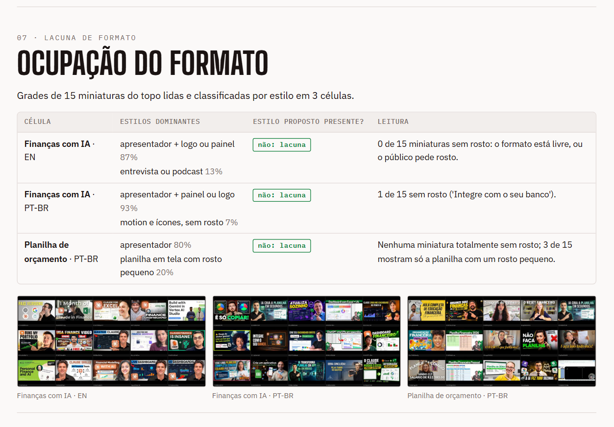

A skill lê grades de 15 miniaturas do topo das células escolhidas (no exemplo, 3 das 10) e classifica o estilo de cada uma. A tabela mostra os estilos dominantes e responde se o estilo proposto já aparece. "Não: lacuna" aponta um formato livre. O texto lembra que formato livre também pode significar que o público quer ver uma pessoa.

## 08 · Oportunidades

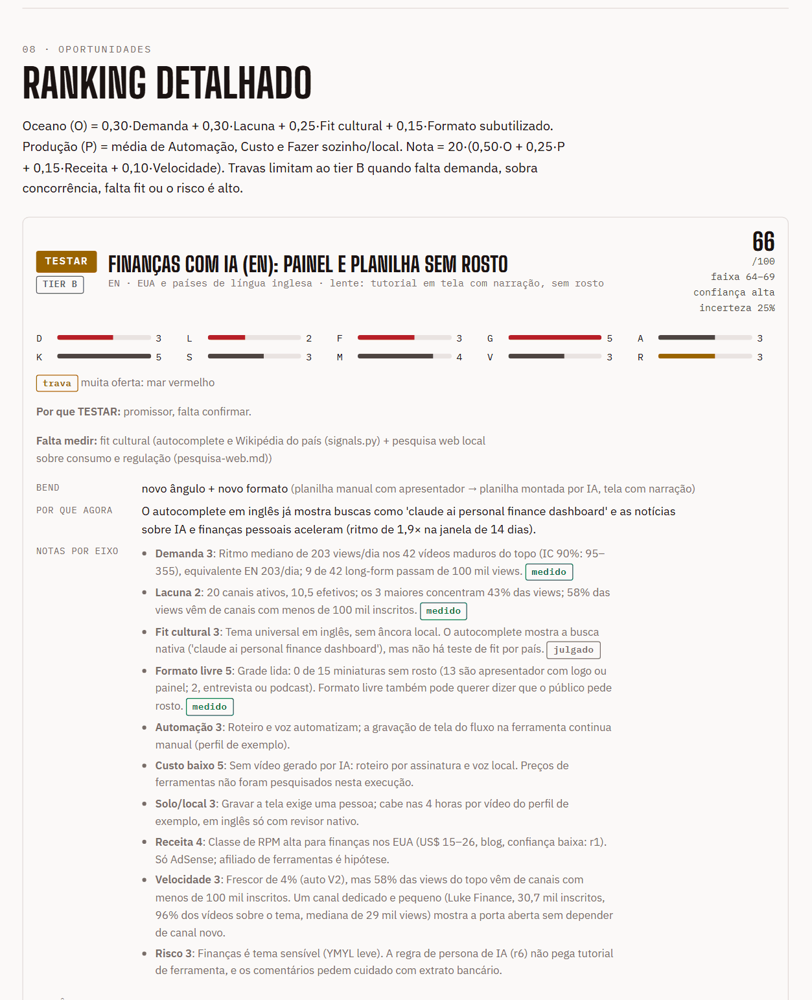

O ranking detalhado abre cada oportunidade em dez eixos de 1 a 5:

- Oceano: **D** demanda, **L** lacuna de oferta, **F** fit cultural, **G** formato subutilizado.
- Produção: **A** automação, **K** custo de IA (5 é barato), **S** fazer sozinho ou local.
- **M** receita, **V** velocidade e **R** risco (5 é muito arriscado).

A nota é 20 × (0,50·Oceano + 0,25·Produção + 0,15·M + 0,10·V). Cada nota por eixo leva a marca **medido** ou **julgado**. Demanda, lacuna, fit ruim e risco alto travam a oportunidade no tier B.

## 09 · Produção

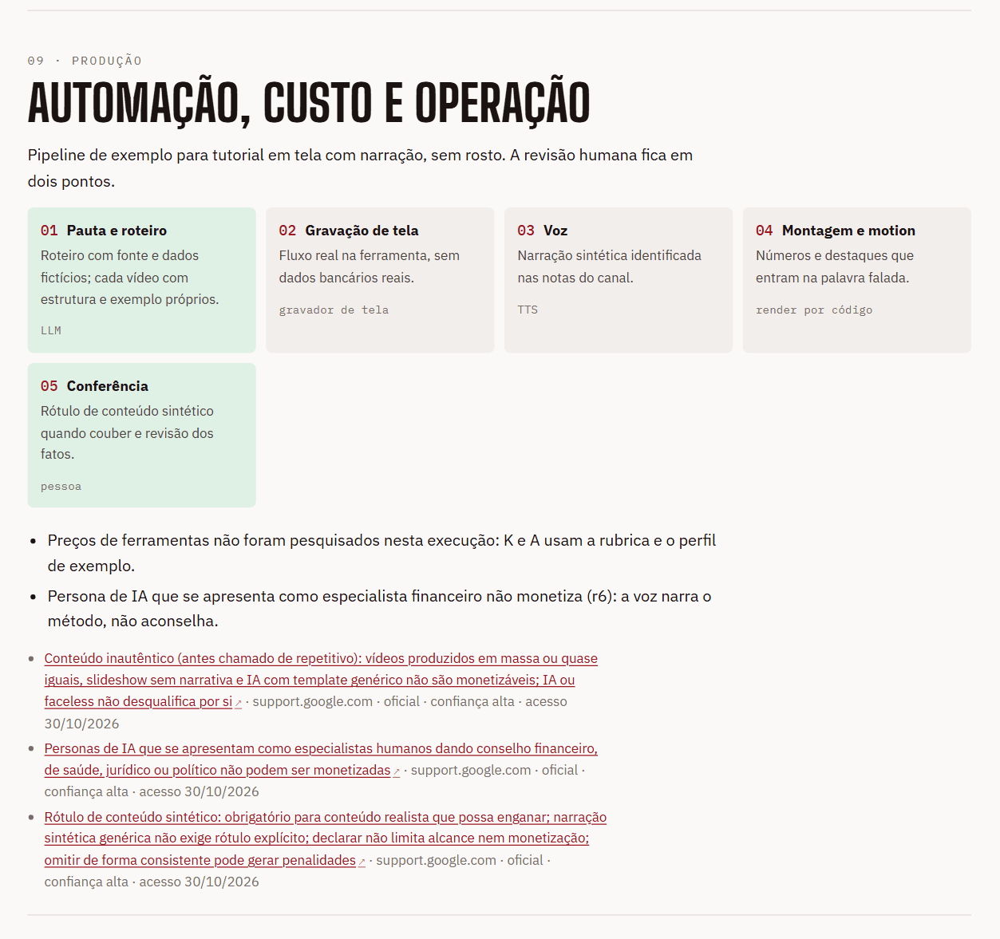

O pipeline de produção, etapa por etapa (pauta, gravação, voz, montagem e conferência), com o que roda sozinho e o que pede uma pessoa. Embaixo ficam as regras do YouTube que pesam nesse formato, com a fonte oficial.

## 10 · Riscos

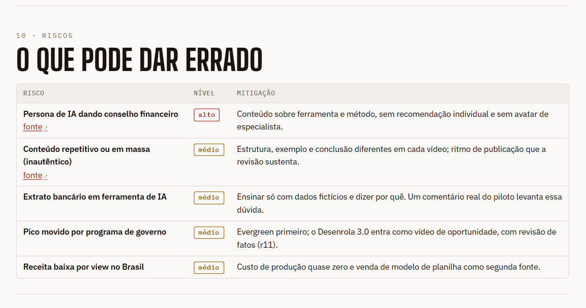

O que pode dar errado, com o nível (alto, médio ou baixo), a mitigação e a fonte da regra quando existe.

## 11 · Plano

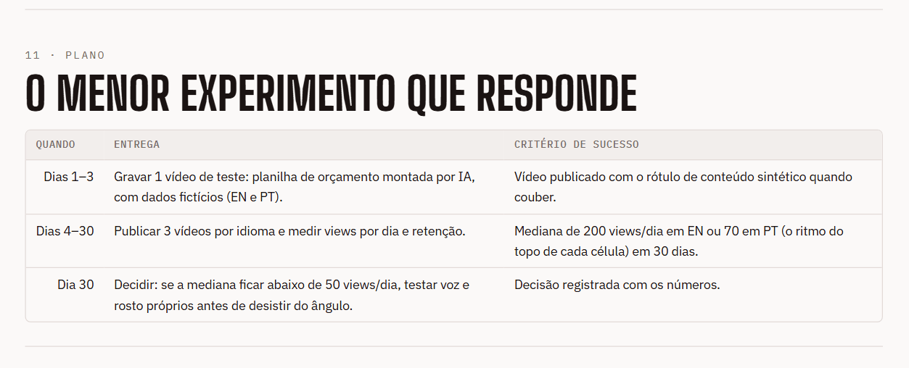

O menor experimento que responde à dúvida: o que entregar em cada prazo e o critério de sucesso, com número. No fim do prazo você decide com a medição, não com opinião.

## 12 · Explorador

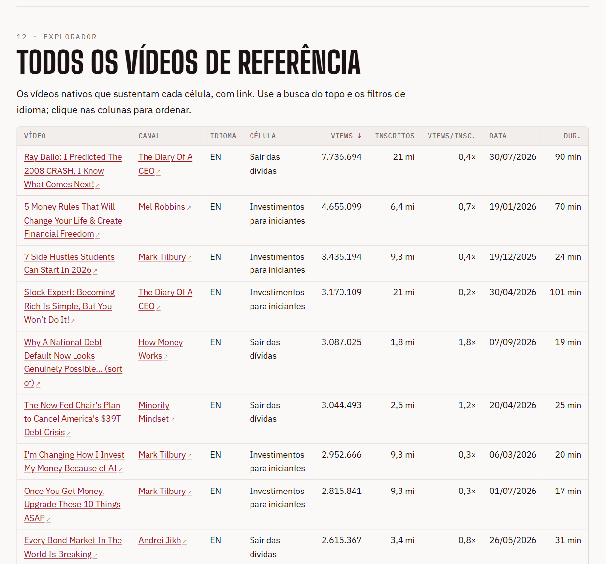

Todos os vídeos nativos que sustentam cada célula, com link para o vídeo e para o canal. Ordene por views, inscritos, views por inscrito, data ou duração, e filtre pelos idiomas do topo.

## 13 · Glossário

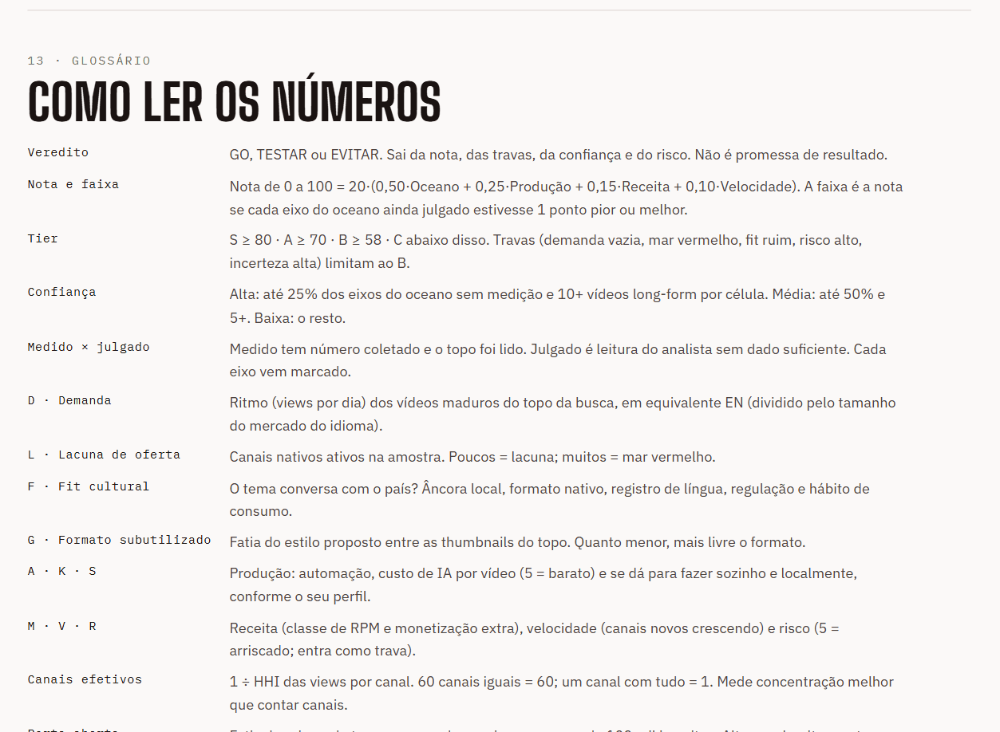

Definições curtas de como ler cada número do relatório, para quem abre o arquivo sem ter lido a metodologia.

## 14 · Método e fontes

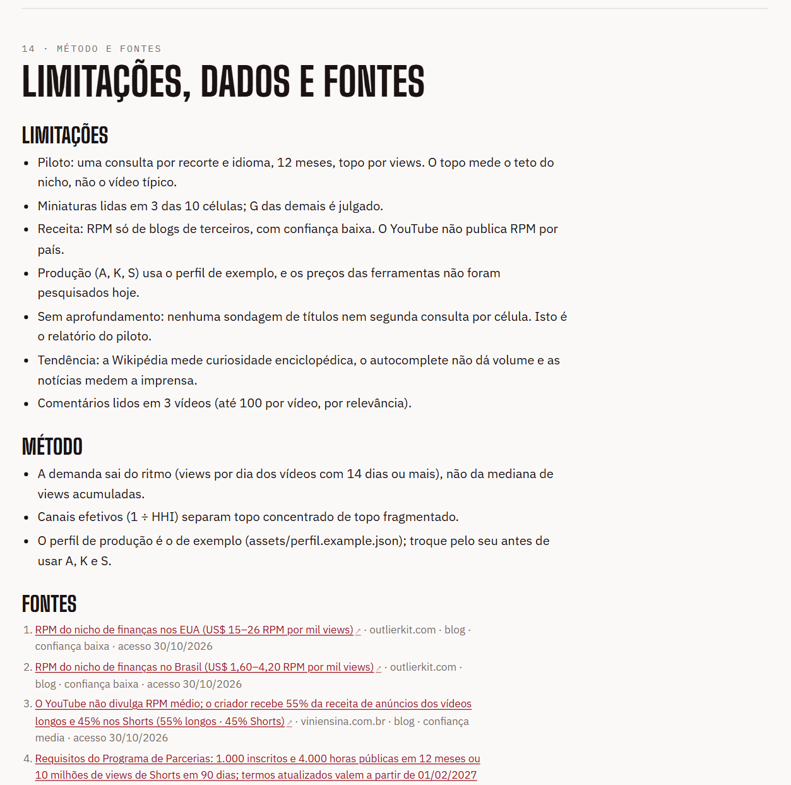

As limitações da análise, o método e a lista de fontes, cada uma com URL, tipo, confiança e data de acesso. Leia as limitações antes de agir sobre o veredito.
